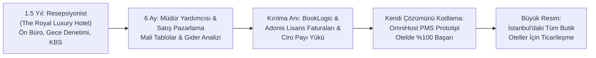
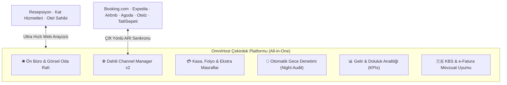
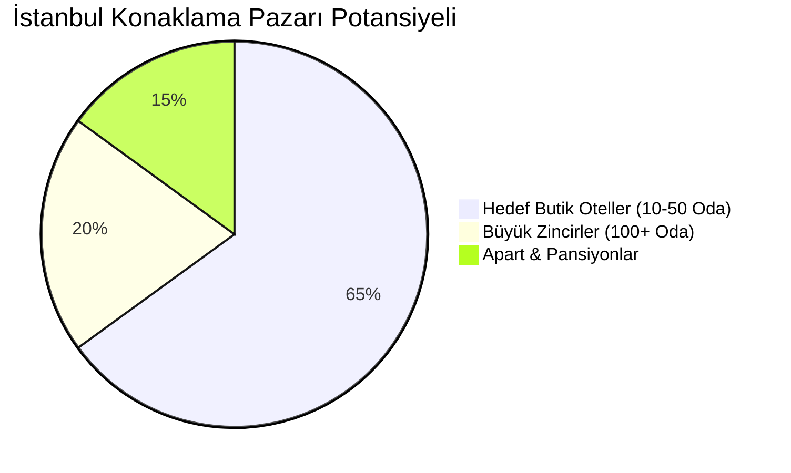
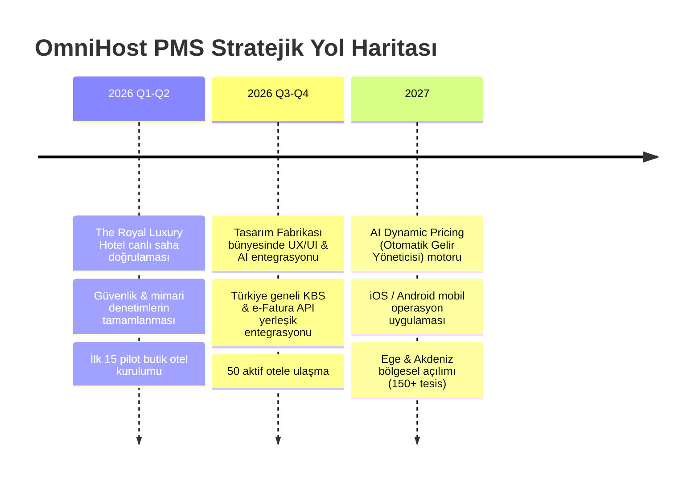

# 📊 OmniHost PMS — Profesyonel Tanıtım & Pitch Deck Sunumu
**Akıllı, Hızlı ve Adil Otel Yönetiminin Yeni Çağı**  
*İstanbul Kültür Üniversitesi · Tasarım Fabrikası Başvurusu & LinkedIn B2B Sunum Dosyası*  
*Hazırlayan:* **Ali Musayev** · *Tarih:* 2026

---

## 📑 Sunum İçindekiler & Sayfa Planı (9 Slayt)

1. **Sayfa 1:** [Kapak & Kurucu Profili](#sayfa-1-kapak--kurucu-profili-ali-musayev-x-omnihost-pms) — *Ali Musayev × OmniHost PMS*
2. **Sayfa 2:** [Kurucunun Sahadan Doğan Hikâyesi](#sayfa-2-kurucunun-sahadan-doğan-hikayesi--sektorel-deneyim) — *The Royal Luxury Hotel Deneyimi & Çıkış Noktası*
3. **Sayfa 3:** [Pazar Analizi & Problem 1](#sayfa-3-pazar-analizi--problem-1-tekellesme--agir-maliyet-tuzagi) — *Tekelleşme & %0.75–%1.25 Ciro Komisyonu Tuzağı*
4. **Sayfa 4:** [Problem Analizi 2](#sayfa-4-problem-analizi-2-eski-nesil-arayuzler--fonksiyonel-kisitlamalar) — *2000'lerden Kalma Hantal Arayüzler & Kopuk Sistemler*
5. **Sayfa 5:** [Çözüm: OmniHost PMS](#sayfa-5-cozum-omnihost-pms--akilli-hizli-ve-adil-otel-ekosistemi) — *Hepsi Bir Arada & %0 Ciro Payı Devrimi*
6. **Sayfa 6:** [Ürün & Canlı Arayüz Vitrini](#sayfa-6-urun--canli-arayuz-vitrini-pms-in-action) — *Oda Rafı, Doluluk KPI'ları & Yeni Toggle-Bar Deneyimi*
7. **Sayfa 7:** [İş Modeli & Karşılaştırmalı Maliyet Analizi](#sayfa-7-is-modeli--karsilastirmali-maliyet-analizi) — *Geleneksel Tekeller vs. OmniHost*
8. **Sayfa 8:** [Hedef Pazar & Büyüme Stratejisi](#sayfa-8-hedef-pazar--buyume-stratejisi-go-to-market) — *İstanbul Butik Otelleri & Saha Hakimiyeti*
9. **Sayfa 9:** [Yol Haritası & Tasarım Fabrikası Hedefleri](#sayfa-9-yol-haritasi--tasarim-fabrikasi-vizyonu) — *Akademik İş Birliği, AI Geleceği & Kapanış*

---

<div style="page-break-after: always;"></div>

# Sayfa 1: Kapak & Kurucu Profili (Ali Musayev x OmniHost PMS)


### **Ali Musayev × OmniHost PMS**
#### *Yeni Nesil Yapay Zekâ Destekli Otel Yönetim Sistemi (PMS) & Kanal Yöneticisi*

> *"Otelcilik yazılımlarında sahada yaşanan gerçek sancıları, bir yazılımcının analitik gözüyle çözmek için yola çıktım. Amacımız; otelcinin alın terini tekelleşmiş komisyonlara kaptırmadığı, şeffaf, modern ve hızlı bir teknoloji çağı başlatmak."*

---

### 👤 Kurucu Kartı

| Alan | Bilgi |
| :--- | :--- |
| **Kurucu & Baş Geliştirici** | **Ali Musayev** |
| **Eğitim** | **Bilgisayar Mühendisliği 3. Sınıf Öğrencisi** (Computer Engineering Junior) |
| **E-posta** | [musayevali729@gmail.com](mailto:musayevali729@gmail.com) |
| **Telefon** | [+90 544 407 2205](tel:+905444072205) |
| **LinkedIn** | [linkedin.com/in/ali-musayev-a37a92245](https://www.linkedin.com/in/ali-musayev-a37a92245/) |
| **Uzmanlık & Yetkinlikler** | Full-Stack Node.js Mimarisi, Otel Operasyonları, Gelir Yönetimi (Revenue Management), Ön Büro Denetimi (Night Audit) |
| **Başvuru Mercii** | **İstanbul Kültür Üniversitesi — Tasarım Fabrikası** |

---

### 🎯 Misyon & Vizyon Özeti
- **Misyon:** İstanbul başta olmak üzere Türkiye'deki butik otelleri hantal, pahalı ve ciro ortaklığı talep eden tekelci yazılımlardan kurtarıp, 15 dakikada devreye alınan bağımsız ve yerli bir PMS gücüne kavuşturmak.
- **Vizyon:** Türkiye'nin 12.000+ turizm tesisine hitap eden, yapay zekâ destekli gelir optimizasyonuna sahip lider bağımsız konaklama teknolojileri platformu olmak.

---

<div style="page-break-after: always;"></div>

# Sayfa 2: Kurucunun Sahadan Doğan Hikâyesi & Sektörel Deneyim

> [!NOTE]
> **Fikir masabaşında değil, otelin resepsiyon tezgahında ve gece vardiyalarında doğdu.**



### 1. Sahadaki 2 Yıllık Yoğun Otelcilik Deneyimi
- **1.5 Yıl — Resepsiyonist (Ön Büro):**
  - Check-in / check-out operasyonları, misafir ilişkileri, oda blokajları ve kat hizmetleri koordinasyonu.
  - Saat 00:00 - 08:00 gece vardiyalarında **Night Audit (Gece Denetimi)** süreçlerini bizzat yönetti; gün sonu devirleri, folio masrafları, oda gelir mutabakatları ve Emniyet KBS bildirimlerindeki sistemsel hataları birebir tecrübe etti.
- **Son 6 Ay — Satış ve Pazarlama Temsilcisi & Müdür Yardımcısı:**
  - Otelin gelir-gider dengesini, OTA (Online Travel Agency - Booking.com, Expedia, Agoda) komisyonlarını ve operasyonel maliyet kalemlerini yönetti.
  - Otelin en büyük dış maliyet kalemlerinden birinin yazılım altyapısı olduğunu ilk elden raporladı.

### 2. Kırılma Noktası: Ağır Yazılım Faturaları
- Otelde kullanılan **BookLogic Channel Manager** ve **Adonis Otel Yönetim Programı** için her ay ödenen devasa lisans bedelleri ve ciro payları, otel yönetiminin bütçesini ciddi şekilde zorluyordu.
- Üstelik bu yüksek bedellere rağmen; sistemler sık sık donuyor, overbooking yaşanıyor ve arayüzler personelin kafasını karıştırıyordu.

### 3. Koddan Çözüme, Çözümden Girişime
- Ali Musayev, Bilgisayar Mühendisliği nosyonunu otelcilik tecrübesiyle birleştirerek:
  > *"Biz neden bu kadar ağır bedelleri bu eski sistemlere ödüyoruz? Kendi sıfır bağımlılıklı, pürüzsüz sistemimizi yapabilirim."* dedi.
- OmniHost PMS'i geliştirdi ve otelde devreye aldı. Sistem devreye girdiği ilk aydan itibaren operasyonel hataları sıfırladı ve maliyetleri düşürdü.
- Başarı kanıtlandıktan sonra şu soru vizyonu büyüttü:
  > *"Bu yazılım bizim otelimizi kurtardıysa, İstanbul'daki yüzlerce butik otelin de tam olarak buna ihtiyacı var."*

---

<div style="page-break-after: always;"></div>

# Sayfa 3: Pazar Analizi & Problem 1: Tekelleşme & Ağır Maliyet Tuzağı

> [!WARNING]
> **Piyasadaki Tekelleşme ve Sektörün Büyük Sırrı: "Ciro Payı Komisyonu"**

```
┌────────────────────────────────────────────────────────────────────────┐
│  GELENEKSEL TEKELLERİN DAYATTIĞI GİZLİ SÖMÜRÜ MODELİ                   │
│                                                                        │
│   Sabit Yıllık Taban Ücret   +   %0.75 - %1.25 Brüt Ciro Payı          │
│   (30.000 ₺ - 80.000 ₺)          (Otel çalıştıkça katlanan ceza!)      │
└────────────────────────────────────────────────────────────────────────┘
```

### 1. Pazardaki Tekelleşme Eğilimi
- Türkiye ve global konaklama teknolojileri pazarında (HotelRunner, BookLogic, Adonis, Fidelio vb.) büyük aktörler sektörü domine etmektedir.
- Butik ve bağımsız oteller, alternatif eksikliğinden ötürü bu tekelci yapıların dayattığı şartları kabul etmek zorunda bırakılmaktadır.

### 2. Ağır Maliyet Yapısı: "Ciro Komisyonu" Tuzağı
- Bu platformlar otellerden yalnızca aylık/yıllık sabit taban lisans ücreti almakla yetinmemektedir.
- En tehlikeli ve haksız model: **Otelin brüt oda cirosu üzerinden %0.75 ila %1.25 arasında değişen ciro payları (komisyonlar)** talep etmektedirler.
- Otel daha yüksek doluluğa ulaştığında, personel daha çok çabalayıp ciroyu artırdığında; yazılım firması hiçbir ek maliyete katlanmaksızın otelin kazancına ortak olmaktadır.

### 3. İşletmeler Üzerindeki Yıkıcı Finansal Yük

| Tesis Ölçeği | Aylık Brüt Ciro | Yıllık Brüt Ciro | %1.0 Ciro Payı Kesintisi | Sabit Taban Lisans Bedeli | Yıllık Toplam Yazılım Maliyeti |
| :--- | :--- | :--- | :--- | :--- | :--- |
| **Küçük Butik (15 Oda)** | 500.000 ₺ | 6.000.000 ₺ | **60.000 ₺** | 35.000 ₺ | **95.000 ₺ / yıl** |
| **Orta Butik (30 Oda)** | 1.250.000 ₺ | 15.000.000 ₺ | **150.000 ₺** | 50.000 ₺ | **200.000 ₺ / yıl** |
| **Üst Butik (50 Oda)** | 2.500.000 ₺ | 30.000.000 ₺ | **300.000 ₺** | 75.000 ₺ | **375.000 ₺ / yıl** |

> [!CAUTION]
> **Sonuç:** Bir butik otelci, kendi emeğiyle kazandığı cironun yılda **150.000 ₺ – 375.000 ₺** gibi devasa bir kısmını sadece yazılım şirketine kaptırmaktadır. Bu rakamlar butik otellerin net kâr marjını doğrudan tüketmekte ve işletmeyi bütçe krizine sokmaktadır.

---

<div style="page-break-after: always;"></div>

# Sayfa 4: Problem Analizi 2: Eski Nesil Arayüzler & Fonksiyonel Kısıtlamalar

Maliyet yükünün ötesinde, pazardaki mevcut yazılımlar operasyonel olarak da çağın gerisinde kalmıştır:

```
┌─────────────────────────────────┐       ┌─────────────────────────────────┐
│   GELENEKSEL PMS DÜNYASI        │       │   OMNIHOST PMS YAKLAŞIMI        │
│                                 │       │                                 │
│  ❌ Windows 98/XP estetiği      │  vs.  │  ✅ Modern Apple/SaaS UX        │
│  ❌ 3-4 haftalık personel eğitimi│       │  ✅ 15 dakikada adaptasyon      │
│  ❌ Kopuk sistemler (PMS ≠ CM)  │       │  ✅ Tek çatı entegre motor      │
│  ❌ Overbooking ve senkron hatası│      │  ✅ Gerçek zamanlı 8 OTA sync   │
│  ❌ Masaüstüne bağımlı, hantal  │       │  ✅ Sıfır kurulum, bulut & web │
└─────────────────────────────────┘       └─────────────────────────────────┘
```

### 1. 2000'lerden Kalma Hantal Masaüstü Arayüzleri
- Mevcut sistemlerin çoğu (Adonis, Fidelio vb.) 15-20 yıllık mimarilere sahiptir.
- Karmaşık, yüzlerce alt pencereden oluşan, gözü yoran ve modern kullanıcı deneyiminden (UX) tamamen uzak ekranlar.
- Resepsiyonist hata yapmaktan korkmakta, menüler arasında kaybolmaktadır.

### 2. Personel Eğitim Maliyeti ve Sirkülasyon Krizi
- Butik otellerde ön büro personeli sirkülasyonu yüksektir.
- Eski sistemleri yeni bir personele öğretmek **en az 3 ila 4 hafta** sürmektedir.
- Bu adaptasyon sürecinde yapılan hatalı girişler, yanlış fiyatlandırmalar ve eksik folio kayıtları otellere doğrudan maddi zarar vermektedir.

### 3. Kopuk Sistemler & "Overbooking" Kabusu
- Birçok otel PMS'i ayrı firmadan, Channel Manager'ı (Kanal Yöneticisi) ayrı firmadan almak zorundadır.
- İki sistem arasındaki API kopuklukları ve gecikmeli senkronizasyon yüzünden, aynı odaya hem Booking.com'dan hem kapıdan (Walk-in) misafir kabul edilmekte; otel misafiri kapıda kalarak binlerce liralık acente cezalarına çarptırılmaktadır.

---

<div style="page-break-after: always;"></div>

# Sayfa 5: Çözüm: OmniHost PMS — Akıllı, Hızlı ve Adil Otel Ekosistemi

OmniHost PMS; sahada kazanılan tecrübe ile en son web teknolojilerini harmanlayan, **%0 Ciro Payı** ilkesini benimsemiş tam entegre konaklama yönetim platformudur.



### 💎 OmniHost'un 4 Temel Değer Önerisi

1. **%0 Ciro Payı Devrimi (Fair Pricing):**
   - **Otelin cirosundan tek bir kuruş bile komisyon ALMIYORUZ.**
   - Sadece şeffaf, sabit ve makul bir aylık abonelik ücreti. Otel 1 Milyon TL de kazansa 10 Milyon TL de kazansa yazılım bedeli değişmez!
2. **15 Dakikada Kullanıma Başlama:**
   - Sade, temiz ve modern arayüz tasarımı.
   - Herhangi bir personelin 15 dakikalık kısa bir brifingle sıfır hatayla kullanabileceği sezgisel iş akışı.
3. **Hepsi Bir Arada (PMS + Channel Manager):**
   - Harici kanal yöneticilerine bağımlılığı bitiren yerleşik 8 kanal senkronizasyon motoru.
   - Fiyat, müsaitlik ve rezervasyonlar tek bir merkezden eşzamanlı güncellenir; overbooking riski sıfıra iner.
4. **Sıfır Dış Bağımlılık & Ultra Hafif Performans:**
   - Saf Node.js çekirdeği ile 30 saniyede ayağa kalkan, donmayan, yüksek performanslı yerli yazılım mimarisi.

---

<div style="page-break-after: always;"></div>

# Sayfa 6: Ürün & Canlı Arayüz Vitrini (PMS in Action)

OmniHost PMS, otelin tüm kritik operasyonlarını tek bir görsel kontrol merkezinde birleştirir.

````carousel

<!-- slide -->

<!-- slide -->

````

### 🖥️ Öne Çıkan Canlı Arayüz Özellikleri

#### 1. Canlı Gösterge Paneli & Oda Durumu Halka Grafiği (Donut Chart)
- **Anlık Metrikler:** Toplam 62 oda, **%72 Doluluk Oranı**, **146.400 ₺ Bu Geceki Oda Geliri**.
- **Canlı Durum Dağılımı:** 44 Dolu, 9 Boş, 8 Rezerve, 1 Arızalı oda.
- **Kusursuz Tema Desteği:** Açık temada klasik lacivert/arduvaz zarafeti, karanlık temada gözü yormayan yüksek kontrastlı (`#546b8a`) profesyonel renk paleti.

#### 2. Adonis Tarzı Kompakt Oda Rafı (Room Rack)
- Tüm odaları kat ve numara hiyerarşisinde listeleyen, tek bakışta oda temizlik durumunu (`Temiz`, `Kirli`, `Arızalı`) ve misafir giriş/çıkış takvimini gösteren kompakt masaüstü tablosu.

#### 3. Yeni Nesil Toggle-Bar (Daraltılabilir Mini Kenar Çubuğu)
- İster üst bardaki `☰` menü düğmesinden, ister logo yanındaki ok butonundan, isterse de evrensel `Ctrl + B` kısayoluyla tek tıkla **68px mini ray** moduna geçiş.
- Geniş rezervasyon tabloları ve oda haritaları için maksimum yatay çalışma alanı; ikon üzerine gelindiğinde beliren akıllı uçan etiketler (tooltip).

#### 4. Tek Tıkla Otomatik Gece Denetimi (Night Audit)
- Saat 00:00'da gün sonunu kapatır; konaklayan tüm odaların geceleme ücretlerini otomatik olarak folyolara işler, iş gününü bir sonraki güne devreder ve resmi KBS çıktılarını hazırlar.

---

<div style="page-break-after: always;"></div>

# Sayfa 7: İş Modeli & Karşılaştırmalı Maliyet Analizi

> [!TIP]
> **OmniHost'un Değer Önermesi: Otelinize Yılda Ortalama 150.000 ₺ ila 300.000 ₺ Net Tasarruf Kazandırır.**

### 📊 Yıllık Maliyet Karşılaştırması (30 Odalı Tipik İstanbul Butik Oteli)

| Kalem | Geleneksel Tekel Çözümleri (HotelRunner + Adonis) | **OmniHost PMS** | Otelin Avantajı |
| :--- | :--- | :--- | :--- |
| **Sabit Yıllık Lisans** | ~45.000 ₺ – 60.000 ₺ | **36.000 ₺** *(3.000 ₺ / ay)* | Daha uygun & sabit |
| **Brüt Ciro Payı / Komisyon** | **%0.75 – %1.25** *(~150.000 ₺ / yıl)* | **%0 (SIFIR)** | **150.000 ₺ Otelin Kasasında Kalır!** |
| **Channel Manager Bedeli** | Ayrı lisans ücreti talep edilir | **Dahil (Sıfır Ek Ücret)** | Tek faturada hepsi bir arada |
| **Kurulum & Danışmanlık** | 15.000 ₺ – 25.000 ₺ | **Ücretsiz / Self-Serve (30 sn)** | Sıfır giriş maliyeti |
| **Eğitim Süresi & Kaybı** | 3-4 Hafta | **15 Dakika** | Anında operasyonel verim |
| **YILLIK TOPLAM GİDER** | **~210.000 ₺ – 260.000 ₺** | **~36.000 ₺** | **%80+ Tasarruf!** |

---

### 💰 Fiyatlandırma Paketleri (Adil SaaS Modeli)

```
┌─────────────────────────┐  ┌─────────────────────────┐  ┌─────────────────────────┐
│       STARTER           │  │       BOUTIQUE          │  │         PRO             │
│   (1 - 15 Oda)          │  │   (16 - 35 Oda)         │  │    (36 - 70 Oda)        │
│                         │  │   ★ EN ÇOK TERCİH EDİLEN│  │                         │
│     1.950 ₺ / ay        │  │     2.950 ₺ / ay        │  │     4.450 ₺ / ay        │
│                         │  │                         │  │                         │
│  • %0 Ciro Payı         │  │  • %0 Ciro Payı         │  │  • %0 Ciro Payı         │
│  • Tam PMS Fonksiyonu   │  │  • 8 Kanal OTA Sync     │  │  • Sınırsız Kullanıcı   │
│  • KBS & Folyo Motoru   │  │  • Gece Denetimi        │  │  • Çoklu Kasa & Rapor   │
│  • E-posta Desteği      │  │  • 7/24 WhatsApp Desteği│  │  • Özel Hesap Yöneticisi│
└─────────────────────────┘  └─────────────────────────┘  └─────────────────────────┘
```

---

<div style="page-break-after: always;"></div>

# Sayfa 8: Hedef Pazar & Büyüme Stratejisi (Go-To-Market)



### 1. Hedef Pazarın Büyüklüğü
- **Birincil Hedef Segment:** İstanbul'un turizm kalbi olan **Sultanahmet, Sirkeci, Beyoğlu, Galata, Karaköy, Kadıköy ve Beşiktaş** hattındaki bağımsız butik oteller (ortalama 10–50 oda kapasiteli yaklaşık **2.500+ tesis**).
- **İkincil Hedef Segment:** Ege ve Akdeniz bölgesindeki (Bodrum, Çeşme, Alaçatı, Kaş, Fethiye) sezonluk butik oteller ile Türkiye genelindeki **12.000 turizm belgeli tesis**.

### 2. Sahadan Gelmenin Verdiği "Haksız Rekabet Avantajı"
- Ali Musayev, 2 yıl boyunca doğrudan bu otellerin resepsiyonunda ve yönetiminde çalıştığı için otel sahiplerinin, müdürlerinin ve resepsiyonistlerin psikolojisine, jargonuna ve gerçek dertlerine 100% hâkimdir.
- Masa başı yazılımcıların aksine, otelcinin dilinden konuşan bir kurucu profili.

### 3. Satış & Dağıtım Kanalları
1. **Doğrudan Saha Ziyaretleri & Sıcak Satış:** Sultanahmet ve Beyoğlu'ndaki otel sahipleriyle yüz yüze görüşmeler; eski yazılım faturalarını inceleyip *"Sadece komisyondan kurtularak yılda 150.000 ₺ cebinizde kalacak"* ROI analizi sunumu.
2. **14 Günlük Koşulsuz Ücretsiz Deneme:** Otelcinin mevcut sistemini kapatmadan, OmniHost'u paralel olarak 14 gün boyunca sıfır riskle denemesi.
3. **LinkedIn B2B Ağı & İçerik Pazarlaması:** Otel teknolojilerindeki gizli komisyon tuzaklarını ve PMS ipuçlarını paylaşarak sektör profesyonellerini doğrudan kendine çeken liderlik içerikleri.

---

<div style="page-break-after: always;"></div>

# Sayfa 9: Yol Haritası & Tasarım Fabrikası Vizyonu

### 🗺️ Stratejik Yol Haritası (2026 - 2027)



---

### 🏛️ Neden İstanbul Kültür Üniversitesi — Tasarım Fabrikası?

İstanbul Kültür Üniversitesi Tasarım Fabrikası bünyesinde yer almak, OmniHost'u bireysel bir projeden kurumsal bir teknoloji şirketine dönüştürecektir:

1. **Multidisipliner Tasarım & UX Mentörlüğü:**
   - Tasarım Fabrikası'nın endüstriyel ve dijital ürün tasarım uzmanlığıyla OmniHost arayüzünün dünya standartlarında bir kullanıcı deneyimine (Apple/Stripe seviyesine) taşınması.
2. **Yapay Zekâ ve Veri Bilimi Desteği:**
   - Akademik kadro ile birlikte oteller için dinamik fiyatlama (Dynamic Pricing) ve doluluk tahminleme yapay zekâ algoritmalarının geliştirilmesi.
3. **Ağ & Ticarileşme Gücü:**
   - Üniversite-sanayi iş birliği, patent/telif süreçleri, teknokent ve girişimcilik ekosistemi fonlarına erişim.

---

### 🤝 Kapanış & İletişim

> **"OmniHost PMS ile otelcilikte tekelci komisyon dönemini kapatıyor, bağımsız otelcinin kendi geleceğini yönettiği adil bir teknoloji çağı başlatıyoruz."**

Gelin, bu dönüşümü birlikte başlatalım.

- **Kurucu:** Ali Musayev (Bilgisayar Mühendisliği 3. Sınıf)
- **Telefon:** [+90 544 407 2205](tel:+905444072205)
- **E-posta:** [musayevali729@gmail.com](mailto:musayevali729@gmail.com)
- **LinkedIn:** [linkedin.com/in/ali-musayev-a37a92245](https://www.linkedin.com/in/ali-musayev-a37a92245/)
- **Proje Konumu:** İstanbul, Türkiye
